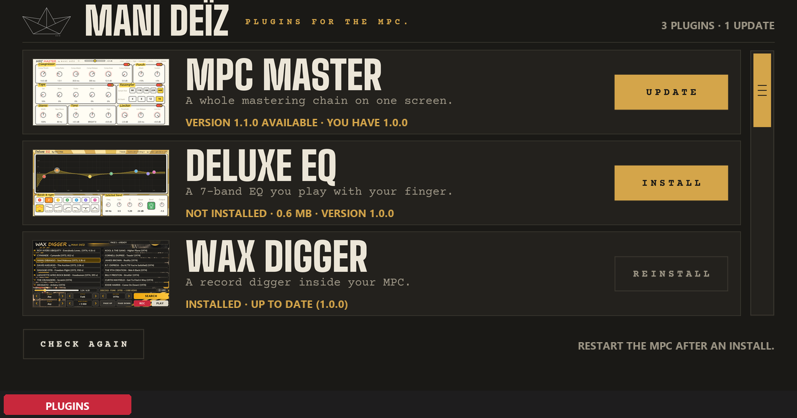

  

<h1 align="center">MANI DEÏZ HUB</h1>

  <b>Every MANI DEÏZ plugin, installed from the MPC itself.</b> 
  Download it once. Then touch INSTALL, and UPDATE when a new version comes out. 
  by <b>MANI DEÏZ</b>

  
  
  
  

  <a href="download/Hub.zip"><b>⬇&nbsp; DOWNLOAD THE HUB</b></a>
  &nbsp;·&nbsp;
  <a href="https://manideiz.github.io/">manideiz.github.io</a>

---

## What it does

The Hub is a plugin that shows the list of MANI DEÏZ plugins on the MPC screen, with one button each:

| Button | |
|---|---|
| **INSTALL** | The plugin is not on your drive: the Hub downloads it and puts it in `VST2 Plugins`. |
| **UPDATE** | A newer version is out: the Hub replaces the one you have. |
| **REINSTALL** | You have the latest one. Touch it to put a clean copy back. |
| **RESTART MPC** | Done: restart the MPC and the plugin is listed under MANI DEÏZ. |

Every download is checked against the fingerprint published with the list before anything is written on your drive.

## Install the Hub

Once, on your computer:

1. Download **[Hub.zip](download/Hub.zip)** and unzip it.
2. Copy the folder found inside `VST2 Plugins` into the `VST2 Plugins` folder at the root of your SD card or USB drive
   (create that folder if it is not there). Do not rename it.
3. On the MPC: **Preferences → Enhancements (Beta)** (scroll the list on the left) → switch on *Enable Enhancements*
   and *External Plugin Support*. Restart the MPC.

Then, on the MPC:

4. Connect the MPC to the network (Wi-Fi, or an Ethernet cable on the MPCs without Wi-Fi).
5. Make a plugin track and pick **Mani Deïz Hub**, under **MANI DEÏZ**.
6. Touch **INSTALL** on the plugins you want, then restart the MPC.

## Which MPCs

Any standalone MPC running **MPC OS 3.10.1 or later**, connected to a network. The zip holds the build for the 64-bit
MPCs (Live III, XL) and for the 32-bit ones (Live, Live II, One, One+, X, X SE, Key 37, Key 61, Force).
If something does not work on yours, send `hub_log.txt` from the Hub's folder on your drive.

## Rights

The Hub is **free to use**. It is **© 2026 MANI DEÏZ, all rights reserved**: please link to this page rather than
re-uploading the zip, and do not sell it, modify it or reuse its code or graphics (see [LICENSE](LICENSE)).

The Hub is an independent plugin. It is not made, endorsed or supported by Akai Professional.
"MPC" and "Akai Professional" are trademarks of inMusic Brands, Inc.

MANI DEÏZ · beats, drums and tools

